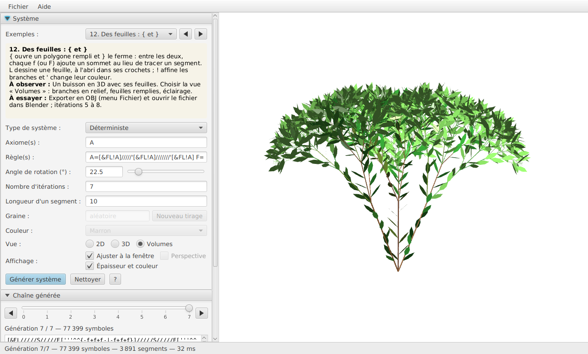
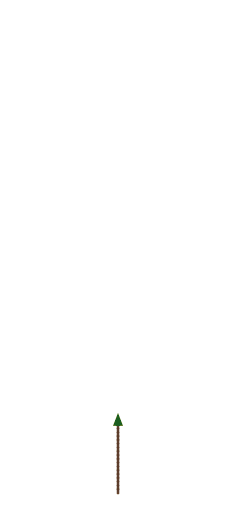
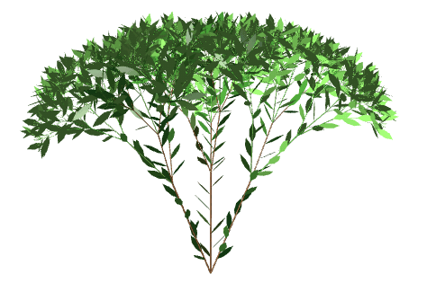
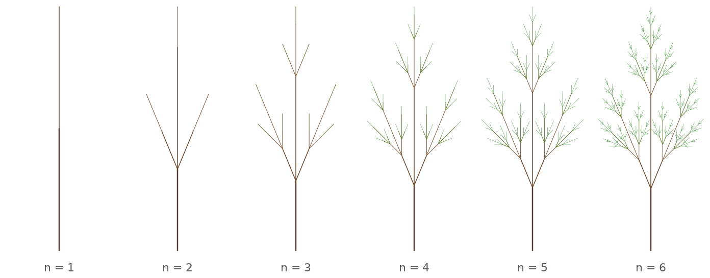
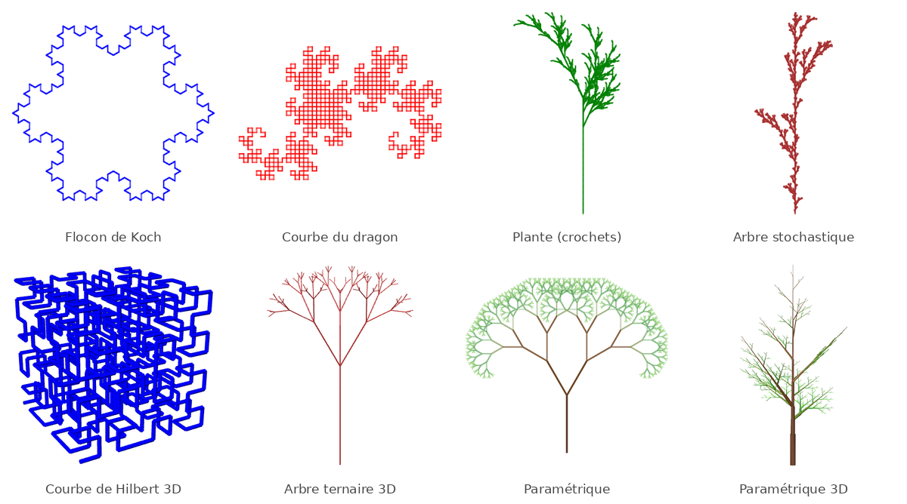
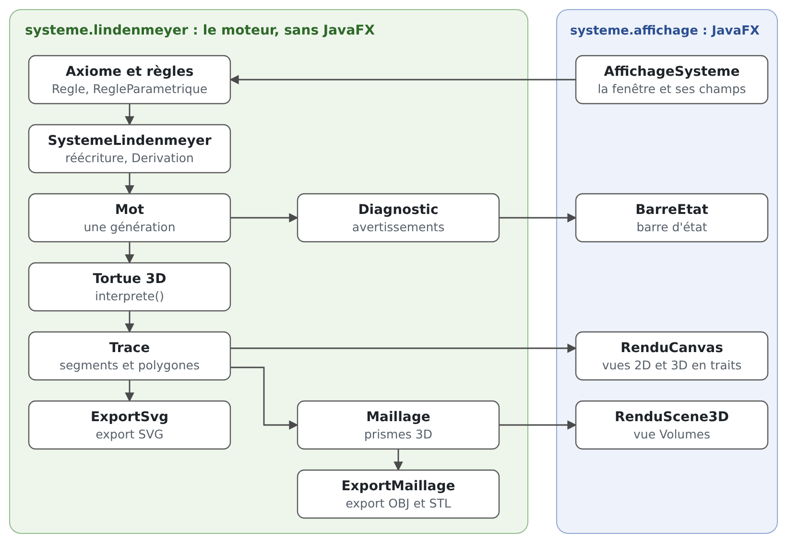

<h1 align="center">Projet Lindenmayer</h1>

<p align="center">
  <strong>Un simulateur de systèmes de Lindenmayer (L-systèmes) : écrire des règles de réécriture,<br>
  puis regarder pousser des plantes et des fractales, en 2D, en 3D et en volumes.</strong>
</p>

<p align="center">
  
  
  
</p>

<p align="center">
  
</p>

<p align="center">
  <a href="#démonstration">Démonstration</a> ·
  <a href="#fonctionnalités">Fonctionnalités</a> ·
  <a href="#installation">Installation</a> ·
  <a href="#utilisation">Utilisation</a> ·
  <a href="#architecture">Architecture</a> ·
  <a href="#tests">Tests</a> ·
  <a href="#contribuer">Contribuer</a>
</p>

> **In English** | A JavaFX application for writing Lindenmayer systems (L-systems) and watching fractal plants grow.
> It supports deterministic, stochastic, context-sensitive and parametric rules, a full 3D turtle, step-by-step
> generations, an animated turtle, lit 3D volumes, and exports to PNG, SVG, OBJ and STL. Clone the repository and run
> `make run`: JavaFX 21 is downloaded on demand. The interface and the documentation are in French.

Un L-système part d'une chaîne (l'**axiome**) et la réécrit plusieurs fois selon des **règles** : `F=F+F--F+F` remplace
chaque `F` par `F+F--F+F`. La chaîne obtenue est ensuite lue comme une suite d'ordres donnés à une tortue qui dessine
(`F` avance en traçant, `+` et `-` tournent). Quelques règles suffisent à produire des courbes fractales, des arbres ou
des buissons ; ce projet permet d'en écrire, d'en modifier et de comprendre chaque étape de leur construction.

## Démonstration

<table>
  <tr>
    <td align="center"></td>
    <td align="center"></td>
  </tr>
  <tr>
    <td align="center"><em>La tortue animée rejoue le tracé</em></td>
    <td align="center"><em>Vue « Volumes » : rotation à la souris</em></td>
  </tr>
</table>

Les générations successives d'un même système (le curseur de l'application passe de l'une à l'autre sans recalcul) :

<p align="center">
  
</p>

Quelques-uns des 14 exemples fournis :

<p align="center">
  
</p>

## Fonctionnalités

- [x] Quatre types de systèmes : **déterministe**, **stochastique** (règles pondérées, graine reproductible),
      **contextuel** (`G<S>D`) et **paramétrique** (`A(l):l>0.1=F(l)[+A(l*0.7)]`)
- [x] Tortue 3D complète : lacet, tangage, roulis, épaisseur `!`, couleur `'`, feuilles remplies `{ }`
- [x] Trois vues : **2D**, **3D** en traits (perspective facultative) et **Volumes** (scène JavaFX 3D éclairée),
      avec rotation, déplacement et zoom à la souris
- [x] Générations pas à pas, chaîne générée reliée au dessin (survol), coloration de la chaîne selon la règle appliquée
- [x] Tortue animée, de 1 à 10 000 segments par seconde
- [x] Vérification des règles pendant la frappe et avertissements (symbole sans effet, crochet jamais refermé…)
- [x] 14 exemples commentés, en parcours progressif, extensibles sans toucher au code
- [x] Enregistrement en `.lsys`, partage d'un système sur une ligne (`lsys1:…`)
- [x] Exports PNG, SVG, OBJ (Blender) et STL (impression 3D)
- [x] 1 047 tests automatisés du moteur, exécutables sans JavaFX
- [x] Makefile et scripts de lancement, avec installation guidée de JavaFX 21
- [ ] Intégration continue (GitHub Actions)
- [ ] Construction avec Maven ou Gradle

## Prérequis

- **JDK 17** ou plus récent (`javac` et `java` dans le `PATH`), par exemple [Eclipse Temurin](https://adoptium.net).
- **JavaFX 21** : rien à faire, son téléchargement est proposé au premier lancement (voir ci-dessous).
- **GNU Make**, **Bash** et **curl** (ou wget) sous Linux et macOS ; sous Windows, `lancer.bat` suffit.
- **Git** pour cloner le dépôt.

## Installation

```bash
git clone https://github.com/senechalmatisse/Projet-Lindenmeyer-system.git
cd Projet-Lindenmeyer-system
make lancer
```

`make lancer` compile le projet (seulement si une source a changé) puis ouvre la fenêtre. Au premier lancement,
JavaFX 21 est cherché dans `branches/lib/javafx-sdk-21*/lib` ; s'il n'y est pas, son installation est proposée :

```text
JavaFX 21 est introuvable dans branches/lib (javafx-sdk-21*/lib).
Il peut etre telecharge depuis Maven Central (JavaFX 21.0.8, environ 10 Mo)
dans branches/lib/javafx-sdk-21.0.8/lib.
Installer JavaFX 21.0.8 maintenant ? [o/N]
```

Les modules `javafx.base`, `javafx.graphics` et `javafx.controls` de la plateforme du JDK (Linux, macOS Intel ou
Apple Silicon, Windows) sont alors téléchargés depuis Maven Central, vérifiés (somme SHA-1) et placés dans
`branches/lib`, qui n'est pas suivi par Git.

### Commandes

| Commande | Effet |
|---|---|
| `make` ou `make aide` | liste les commandes |
| `make lancer` | compile si besoin et ouvre l'application |
| `make tester` | compile et exécute les tests du moteur (sans JavaFX) |
| `make javafx` | installe JavaFX 21 sans poser de question |
| `make verifier` | affiche le JDK et le JavaFX utilisés |
| `make jar` | reconstruit `jar/executable.jar` |
| `make executer-jar` | lance `jar/executable.jar` |
| `make doc` | génère la Javadoc dans `branches/doc` |
| `make nettoyer` | supprime les fichiers compilés et la Javadoc (JavaFX est conservé) |

Les noms anglais fonctionnent aussi : `make run`, `make test`, `make build`, `make check`, `make run-jar`,
`make javadoc`, `make clean`.

- JavaFX 21 déjà installé ailleurs : `make lancer JAVAFX=/chemin/javafx-sdk-21/lib` (le dossier `lib` d'un SDK de
  [gluonhq.com](https://gluonhq.com/products/javafx)).
- Autre version de JavaFX 21 : `make javafx JAVAFX_VERSION=21.0.x`.
- Sans `make` : `./lancer.sh` et `./tester.sh` (Linux, macOS), `lancer.bat` et `tester.bat` (Windows). `lancer.bat`
  propose lui aussi de télécharger JavaFX 21 (avec PowerShell) ; tous acceptent le dossier `lib` d'un SDK en
  paramètre : `./lancer.sh /chemin/javafx-sdk-21/lib`.

## Utilisation

1. Choisir un exemple dans la liste (◄ / ► pour parcourir) : il est dessiné aussitôt et un encadré explique ce qu'il
   faut observer et ce qu'on peut essayer.
2. Modifier l'axiome, les règles, l'angle ou le nombre d'itérations : le champ des règles passe en rouge si une règle
   est mal formée.
3. Cliquer sur « Générer système ».
4. Explorer : curseur des générations, vues 2D, 3D et Volumes, souris (glisser, molette, double-clic), tortue animée.
5. Enregistrer le système ou exporter la figure (menu Fichier). Le bouton « ? » (ou F1) ouvre l'aide.

### Écrire son premier L-système

| Champ | Valeur | Rôle |
|---|---|---|
| Axiome | `F` | la chaîne de départ : un segment |
| Règles | `F=F+F--F+F` | chaque segment devient quatre segments avec une pointe |
| Angle | `60` | `+` et `-` tournent de 60° |
| Itérations | `3` | la règle est appliquée trois fois |

On obtient la courbe de Koch ; avec l'axiome `F--F--F`, le flocon de Koch. Ajouter des crochets (`[` mémorise la
position, `]` y revient) permet de faire des branches : `X=F-[[X]+X]+F[+FX]-X F=FF` avec l'axiome `X` et un angle de
25° dessine une plante.

<details>
<summary><strong>Guide détaillé de l'interface</strong></summary>

#### Champs et options

- **Axiome(s)** : la chaîne de départ (les espaces sont ignorés).
- **Règles** : séparées par des espaces, au format `[G<]S[>D][(poids)]=remplacement` (systèmes paramétriques : voir
  plus bas). Le champ passe en rouge pendant la frappe si une règle est mal formée ou refusée par le type choisi (le
  message est dans l'infobulle) ; le panneau « Règles comprises » montre comment chaque règle a été lue (symbole,
  contextes, poids, remplacement).
- **Angle** en degrés (le point et la virgule sont acceptés), **itérations** (≥ 0), **longueur** d'un segment en
  pixels. Le curseur à côté de l'angle (0 à 180°, pas de 0,5°) et le champ restent synchronisés : modifier l'angle
  redessine aussitôt la chaîne affichée, sans régénérer.
- **Graine** (systèmes stochastiques et paramétriques) : vide, une graine est tirée au hasard puis écrite dans le
  champ ; « Générer » la réutilise (même figure), « Nouveau tirage » en tire une autre. Recopier une graine redonne la
  même figure.
- **Vue** : « 2D » (de face), « 3D » (traits) ou « Volumes ». Après chaque génération, une figure qui sort du plan
  s'ouvre en 3D (ou en volumes si ce mode était choisi) et une figure plane en 2D.
- **Ajuster à la fenêtre** (coché par défaut) : la figure remplit la zone de dessin. Décoché : taille réelle (longueur
  en pixels), réduite seulement si elle déborde.
- **Perspective** (vue 3D, décochée par défaut : la vue orthographique est plus lisible pour apprendre).
- **Épaisseur et couleur** : chaque segment est tracé avec sa largeur et une couleur d'une palette allant du brun
  (tronc) au vert clair (extrémités). Si la chaîne contient `!` ou `'`, ce sont ces symboles qui décident (et la case
  se coche toute seule) ; sinon, l'épaisseur et la couleur suivent la profondeur des branches. Décoché : trait simple
  de 1 pixel, de la couleur choisie dans la liste.

#### Souris

- Vue 3D et volumes : glisser fait tourner la figure ; glisser avec le bouton droit (ou Maj + glisser) la déplace.
- Vue 2D : glisser déplace la figure.
- Molette : zoom autour du curseur. Double-clic : retour à la vue de face, sans zoom ni déplacement.
- Au-delà de 50 000 segments, la figure est allégée pendant qu'on la fait tourner, puis redessinée entièrement au
  relâchement. En vue 3D, les traits lointains sont plus pâles.

#### Volumes

Scène JavaFX 3D, avec les mêmes gestes. Chaque segment devient un prisme fermé à 6 facettes (rayon 0,1 × la longueur,
× 0,8 par niveau de branche, ou selon l'épaisseur si « Épaisseur et couleur » est coché), éclairé ; les polygones
(feuilles) sont remplis. Le maillage est construit en arrière-plan au-delà de 10 000 segments. Au-delà de 50 000
segments, ou si la machine ne sait pas afficher de scène 3D (le choix est alors grisé), la vue 3D en traits est
utilisée et la barre d'état l'indique.

#### Parcours d'exemples

1. l'axiome seul, 2. une règle (Koch), 3. même règle, autre axiome (flocon), 4. des symboles qui ne se dessinent pas
(dragon), 5. les crochets (plante), 6. le hasard (arbre stochastique), 7. le contexte (plume à signal), 8 à 10. la 3D
(cube, courbe de Hilbert, arbre ternaire), 11. épaisseur et couleur, 12. des feuilles (polygones), 13 et 14. systèmes
paramétriques (en 2D, puis en 3D avec des conditions).

Les exemples sont lus dans `branches/src/systeme/affichage/exemples.txt` (UTF-8) : on peut en ajouter sans toucher au
code. Format : un bloc par exemple, blocs séparés par une ligne `---` ; une ligne `clé: valeur` par paramètre (coupée
au premier `:`) ; une ligne qui commence par au moins deux espaces prolonge la valeur précédente ; les lignes qui
commencent par `#` sont ignorées. Clés : `nom`, `type` (`Déterministe`, `Stochastique`, `Contextuel`,
`Paramétrique`), `axiome`, `regles` (peut être vide), `angle`, `iterations`, `longueur`, et, facultatives,
`description`, `observer`, `essayer`. Un exemple invalide est ignoré et signalé dans la barre d'état ; si le fichier
est absent ou ne contient aucun exemple valide, quatre exemples intégrés au programme sont proposés.

#### Générations pas à pas

Le panneau « Chaîne générée » garde toutes les générations, de l'axiome (génération 0) à la dernière itération : le
curseur choisit celle qui est dessinée, sans régénérer (pour un système stochastique, toutes viennent du même tirage).
Les boutons ◄ / ► reculent ou avancent d'un pas ; ► sur la dernière génération en calcule une nouvelle. La chaîne de
la génération choisie s'affiche dessous (tronquée à 5 000 caractères ; « Copier la chaîne » la copie entière). Les
générations sont conservées tant que leur longueur totale ne dépasse pas 2 000 000 de symboles ; au-delà, les plus
longues (sauf la dernière) sont libérées et le panneau l'indique.

#### Relier la chaîne et le dessin

- Survoler un segment du dessin surligne le `F` qui l'a tracé dans la chaîne ; survoler un `F` de la chaîne surligne
  son segment en rouge (jusqu'à 100 000 segments, en vues 2D et 3D).
- « Colorer selon la règle » colore chaque morceau de la chaîne selon la règle qui l'a produit, avec une légende
  (générations d'au plus 20 000 symboles).
- Tortue animée : la lecture rejoue le tracé segment par segment (la tortue au bout du trait, son symbole surligné
  dans la chaîne), la pause le suspend, le retour au début vide le dessin ; le curseur règle la vitesse.

#### Barre d'état et avertissements

La barre du bas résume la figure (« Génération 4/4 | 596 symboles | 256 segments | 3 ms ») et affiche en orange ce qui
peut expliquer une figure vide ou inattendue, sans bloquer la génération : aucun `F` dans la chaîne, symbole sans
effet (faute de frappe ?), règle jamais appliquée, crochet ouvrant jamais refermé, polygone jamais fermé, 0 itération
alors qu'il y a des règles. Les erreurs bloquantes (règle mal formée, crochet fermant sans crochet ouvrant, plus de
2 000 000 de symboles générés...) s'affichent dans une boîte de dialogue.

#### Fichiers (menu Fichier)

- **Enregistrer le système / Ouvrir un système** : fichier `.lsys` (texte UTF-8 au format `Properties` : type,
  axiome, règles, angle, itérations, longueur, graine).
- **Copier le système / Coller un système** : le système tient sur une ligne (`lsys1:` suivi du texte en Base64), à
  coller dans un message.
- **Exporter en PNG** : l'image affichée (fond blanc).
- **Exporter en SVG** : la vue affichée (2D, ou projection 3D courante), avec les mêmes couleurs et épaisseurs
  (jusqu'à 200 000 segments).
- **Exporter en OBJ** (pour Blender : y vers le haut) et **en STL** (impression 3D, STL binaire, z vertical, échelle
  en millimètres par unité de longueur, extrémités fermées et rayon d'au moins 1 mm par défaut). Les prismes se
  recouvrent aux jonctions : le trancheur en fait l'union. Exports possibles jusqu'à 50 000 segments.

Tous les nombres écrits dans les fichiers (SVG, OBJ, STL, `.lsys`) ont un point décimal, quelle que soit la langue du
système.

</details>

### Types de systèmes

| Type | Règles acceptées | Exemple |
|---|---|---|
| Déterministe | une seule règle par symbole, sans contexte ni poids | `X=X+YF+ Y=-FX-Y` |
| Stochastique | plusieurs règles par symbole, tirées au hasard selon leur poids relatif (1 par défaut) ; contextes acceptés | `F(2)=F[+F]F[-F]F F=F[+F]F` |
| Contextuel | une règle `G<S>D=...` ne réécrit `S` que s'il est précédé de `G` et/ou suivi de `D` | `b<a=b b=a` |
| Paramétrique | les symboles portent des nombres ; les règles les calculent, avec condition et poids facultatifs | `A(l)=F(l)[+(30)A(l*0.7)]` |

Un symbole sans règle applicable est conservé tel quel. Contexte : c'est le voisin immédiat ; les branches `[...]`
sont sautées. Si plusieurs règles s'appliquent, celle qui a le plus de contextes l'emporte (à égalité, la première pour
le contextuel, un tirage pondéré pour le stochastique).

<details>
<summary><strong>Systèmes paramétriques</strong></summary>

Les parenthèses donnent des **paramètres** (et non un poids) : l'axiome est une suite de modules à valeurs constantes
(`A(1,10)`), et une règle a la forme `S(p1,p2,…):condition~poids=successeur`.

- La règle ne s'applique qu'aux modules `S` qui ont exactement ce nombre de paramètres, et seulement si la
  `condition` (facultative) est vraie : `A(l):l>0.1=…`. Dans une condition, l'égalité s'écrit `==`.
- Le `poids` (facultatif, 1 par défaut) sert au tirage au hasard quand plusieurs règles s'appliquent : `A(l)~3=…`.
- Le successeur calcule les paramètres de ses modules : `F(l)[+(30)A(l*0.7)]`. Opérations : `+ - * / % ^`
  (puissance), comparaisons `== != < <= > >=`, `&&`, `||`, `!`, parenthèses, fonctions `sqrt`, `abs`, `min`, `max`,
  `floor`. Une division par zéro donne une erreur qui cite la règle et le module.
- Les règles se séparent par des points-virgules (elles peuvent alors contenir des espaces) :
  `A(l,w) = !(w)F(l)[+(30)A(l*0.7,w*0.7)] ; B = F`. Sans point-virgule, elles se séparent par des espaces.
- La chaîne affiche les paramètres (`F(1)[+(30)A(0.7)]`, 6 chiffres significatifs au plus).

</details>

### Symboles dessinés

La chaîne est lue de gauche à droite comme des ordres donnés à une tortue 3D, qui part de l'origine en regardant vers
le haut de l'écran (cap H), avec sa gauche L vers la gauche de l'écran et son « haut » U vers l'observateur.

| Symbole | Effet | Avec un paramètre (paramétrique) |
|---|---|---|
| `F` | avance d'un pas en traçant un segment | `F(l)` : avance de l × longueur |
| `f` | avance d'un pas sans tracer | `f(l)` : idem sans tracer |
| `+` / `-` | lacet : tourne à gauche / à droite de l'angle (autour de U) | `+(a)` : tourne de a degrés |
| `&` / `^` | tangage : pique / cabre de l'angle (autour de L) | `&(a)`, `^(a)` |
| `\` / `/` | roulis : à gauche / à droite de l'angle (autour de H) | `\(a)`, `/(a)` |
| `\|` | demi-tour (lacet de 180°) | |
| `!` | largeur du trait × 0,7 (sans descendre sous 0,15) | `!(w)` : largeur w |
| `'` | couleur suivante de la palette (du brun au vert, 8 couleurs) | `'(i)` : couleur i (0 à 7) |
| `[` / `]` | mémorise / restaure l'état complet de la tortue (position, orientation, largeur, couleur) | |
| `{` / `}` | ouvre / ferme un polygone rempli (feuille) : entre les deux, `F` et `f` ajoutent un sommet | |

Sans paramètre, tous les virages utilisent **un seul angle** : pour tourner d'un autre angle, répéter le symbole
(`////` à 30° = 120° de roulis). Les autres symboles (`X`, `Y`, `S`, `A`...) ne servent qu'à la réécriture.
Polygones : la position où `{` est lu est le premier sommet ; `}` ferme le polygone. Les polygones ne s'imbriquent
pas ; un `{` jamais fermé est ignoré (avertissement) ; un `}` sans `{` est une erreur. Dans la vue « Volumes », un
polygone est découpé en triangles depuis son premier sommet (il doit être convexe).

## Architecture

```text
Projet-Lindenmeyer-system/
├── Makefile                  make lancer, make tester, make jar...
├── installer-javafx.sh       recherche et installation de JavaFX 21
├── lancer.sh / lancer.bat    lancement sans make (Linux et macOS / Windows)
├── tester.sh / tester.bat    tests sans make
├── branches/
│   ├── src/systeme/
│   │   ├── lindenmeyer/      moteur, sans JavaFX : réécriture, tortue 3D, maillage, exports
│   │   └── affichage/        interface JavaFX et fichier exemples.txt
│   ├── test/                 TestsSystemes.java
│   └── lib/                  JavaFX 21 (téléchargé, non suivi par Git)
├── jar/                      executable.jar et son manifeste
└── docs/images/              captures du README
```

Le moteur ne dépend pas de JavaFX : il se teste seul et pourrait servir à une autre interface. Le chemin d'une figure,
de la saisie à l'écran :

<p align="center">
  
</p>

- `systeme.lindenmeyer` (moteur) : `Generation` (interface), `SystemeLindenmeyer` (réécriture, `Derivation`, tortue
  3D) et ses quatre types (`SystemeDeterministe`, `SystemeStochastique`, `SystemeContextuel`, `SystemeParametrique`),
  `TypeSysteme`, `Regle`, `RegleParametrique`, `Expression`, `Mot` (une génération), `Trace` (la figure), `Vue` et
  `Projection` (cadrage, 3D), `Maillage`, `ExportMaillage` (OBJ, STL), `ExportSvg`, `SauvegardeSysteme` (`.lsys`,
  presse-papiers), `Diagnostic` (avertissements), `Exemple` et `Exemples` (fichier d'exemples).
- `systeme.affichage` (JavaFX) : `AffichageSysteme` (la fenêtre), `GenerationGraphique` et `SystemeGraphique` (un
  système du moteur qui sait se dessiner), `ZoneDessin`, `RenduCanvas`, `RenduScene3D`, `PanneauChaine`,
  `TableRegles`, `BarreEtat`, `FenetreAide`, `Exports`, `Formats`, `Icones`.

## Technologies

- **Java 17+** (le code source reste compatible Java 11)
- **JavaFX 21** : contrôles, `Canvas` pour les traits, `SubScene` et `MeshView` pour les volumes
- **GNU Make** et **Bash** (Linux, macOS), scripts **cmd** et **PowerShell** (Windows)
- Aucune autre dépendance

## Tests

```bash
make tester        # ou ./tester.sh, ou tester.bat
```

Le moteur (`systeme.lindenmeyer`) n'importe pas JavaFX : les tests se compilent et se lancent avec `javac` et `java`
seuls. Ils s'arrêtent au premier échec (code de sortie 1) et affichent sinon « OK : 1047 tests réussis ». Ils
couvrent la réécriture (déterministe, stochastique, contextuelle, paramétrique), la dérivation et sa mémoire bornée,
les avertissements, la graine, l'équivalence de la tortue 3D avec le tracé 2D d'origine (exemples et 300 chaînes au
hasard), la projection et le zoom, le fichier d'exemples, l'épaisseur et la couleur, les polygones, le maillage, les
exports OBJ, STL et SVG (sous une locale française), la provenance des règles, l'évaluateur d'expressions, et la
sauvegarde `.lsys`.

<details>
<summary><strong>Compiler à la main, sans make ni script</strong></summary>

Depuis `branches/`, avec le SDK installé par `make javafx` (adapter le chemin ; sous Windows, remplacer `:` par `;`
dans les `-cp` et `cp` par `copy`) :

```bash
# compiler et lancer
javac -encoding UTF-8 --module-path lib/javafx-sdk-21.0.8/lib --add-modules javafx.controls \
      -d build src/systeme/*/*.java
cp src/systeme/affichage/exemples.txt build/systeme/affichage/
java --module-path lib/javafx-sdk-21.0.8/lib --add-modules javafx.controls \
     -cp build systeme.affichage.AffichageSysteme

# tester le moteur, sans JavaFX
javac -encoding UTF-8 -d build-moteur src/systeme/lindenmeyer/*.java
javac -encoding UTF-8 -cp build-moteur -d build-tests test/TestsSystemes.java
java -cp build-moteur:build-tests TestsSystemes

# reconstruire et lancer l'archive jar
jar --create --file ../jar/executable.jar --manifest ../jar/MANIFEST.MF -C build .
java --module-path lib/javafx-sdk-21.0.8/lib --add-modules javafx.controls -jar ../jar/executable.jar
```

</details>

## Contribuer

Les contributions sont les bienvenues : signaler un problème ou proposer une idée dans les *issues*, ou proposer une
modification :

1. créer une branche à partir de `main` ;
2. garder le moteur `systeme.lindenmeyer` indépendant de JavaFX et ajouter un test dans `TestsSystemes.java` pour
   chaque comportement nouveau ;
3. vérifier que `make tester` affiche « OK » et que `make lancer` ouvre la fenêtre ;
4. ouvrir une *pull request* qui décrit le changement (une capture aide pour tout ce qui se voit).

Un nouvel exemple s'ajoute simplement dans `branches/src/systeme/affichage/exemples.txt`.

## Références

- P. Prusinkiewicz et A. Lindenmayer, [*The Algorithmic Beauty of Plants*](http://algorithmicbotany.org/papers/#abop),
  Springer, 1990 : la référence des L-systèmes, d'où viennent plusieurs exemples (buisson, arbre monopode).
- [L-system](https://en.wikipedia.org/wiki/L-system) sur Wikipédia (en anglais).

